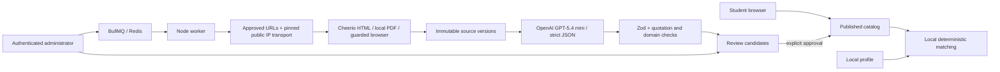

# Architecture

## Two independent paths

The public interface reads only published PostgreSQL records (or an explicitly separate in-memory fictional catalog). Matching is evaluated on the student's device. The administrator endpoints require database-backed sessions for each request, not just page navigation.

## Persistence and publication

Prisma models separate universities, approved sources, degree programs, application intakes/routes, requirements, scholarships and eligibility links, annual costs, documents, source versions, quotations, jobs/logs, usage, sessions and review records. Arrays represent scalar lists; relationships use foreign keys.

An extraction is a candidate, never automatic administrator verification. Exact excerpts must occur in the immutable source text, and official URLs must belong to approved domains. Explicit review runs in a serializable transaction. It records the original candidate, previous published program state, revised payload, reviewer and timestamp. Values with matching scopes are replaced only by approval; previous source versions and audit payloads remain.

Source-backed means a citation passed structural checks, not semantic certainty. Admin-verified means a human explicitly approved. Conflicting and stale evidence cannot establish definitive eligibility. Incomplete coverage stays unknown even if every known score passes.

Institution-wide scholarships are linked at university scope and filtered by supported degree levels and explicit restrictions. Program-specific scholarship relationships remain separate. Institution-wide admission requirements are not blindly copied to every degree.

## Matching

Academic fit, application eligibility, and financial fit remain independent. Mandatory checks use three-valued logic. Missing values, unsupported equivalencies, outdated evidence and unresolved conflicts become UNKNOWN; they never silently PASS.

Dates require an explicit year, deadline and timezone. Multiple application routes are alternatives: one verified open route can satisfy the route condition. Older-year requirement evidence cannot automatically apply to a future intake. English-test alternatives and complex qualification pathways remain manual OTHER rules until a verified rule representation exists.

Financial scenarios never stack scholarships. They show no award, an eligible competitive award, or verified guaranteed terms. Scholarship eligibility is separate from award status. A full ride covers tuition, living and other mandatory costs. Partial/semester prices and currency mismatches cannot create a precise annual affordability claim.

Sorting is lexicographic: confirmed failures last, relevant field first, financial feasibility, evidence completeness, then research recency. There is no opaque numeric match score.

## Crawling and untrusted content

Crawlee controls queues, depth, retry and page limits. CheerioCrawler deliberately skips its built-in network navigation; a pinned-IP transport fetches bounded data and Cheerio extracts text/links. This avoids a validate-then-unrestricted-fetch SSRF vulnerability.

Each URL and redirect must use HTTP(S), approved hostnames, ordinary ports and no credentials. Every resolved address must be globally routable; the actual socket connects to the validated IP with the original Host and TLS SNI. Private, loopback, link-local, metadata, mapped private IPv6 and reserved ranges are rejected. Robots rules are loaded before content and failures are conservative. Same-host requests are delayed; network concurrency is bounded.

Browser fallback requires an explicit source flag and sparse normal HTML. It uses a separate Crawlee queue. Browser HTTP requests are intercepted and fulfilled through the same guarded transport; service workers and WebSockets are disabled. Only bounded approved resources load. It does not use proxies, evasion, login or CAPTCHA solving. Production deployment should add an OS/container egress boundary as defense in depth.

Sources are never instructions or executable server code. Only the browser-rendering path intentionally runs public JavaScript in Chromium. Model instructions remain a stable prefix and explicitly separate source data from commands. The model receives relevant text windows capped at 18,000 characters, not entire websites.

## Program registry and targeted extraction

Universities whose approved sources include `purpose = "registry"` are researched per registered program, not per page. `prisma/registry.ts` lists real degrees (title, level, official page) and the institution pages that state international admission, fee and scholarship facts. A run crawls and stores pages with no model call, ranks the stored pages for each published program (`programDocScore`: the program page, registry pages, pages that pass the fact gate), and makes one model call per program over up to seven pages labelled `### SOURCE: <url>`. Every claim cites its page in `sourceUrl`. Quotations that miss by a word or space are snapped to the real source passage (`snapExcerpt`); anything else fails the verbatim check and is flagged. The candidate stores `programId` and a `bundleHash`; unchanged pages and an unchanged prompt version skip the call. Approval resolves each claim's evidence to its own cited page. Universities without registry pages keep the per-page flow.

Before a candidate is stored, free deterministic checks remove what the quoted text cannot back up (`dropUnquoted`, `pruneClaims`, `widenExcerpt` in `lib/research/relevance.ts`): claims not verbatim in their cited page, cost amounts absent from their excerpt or unlabelled as living costs or fees, several amounts in one cost entry, "up to" coverage or stipends, scholarship names not in their quote, qualification lists without a threshold, fragments, local JUPAS-only rules, transfer/postgraduate pages, and autumn intakes whose dates fall after the intake starts. Each removal is recorded as a `Pruned:` issue. Thresholds must be printed in their own quote, and a test whose scale changes by date (for example TOEFL before and after 21 January 2026) becomes an unevaluated `OTHER` rule.

Model output varies between runs, so a new candidate also folds in claims from the program's candidates of the last 14 days (`mergeClaims`); each must still be quoted verbatim on the current pages, otherwise `dropUnquoted` removes it.

Registry sources have purpose `registry` (every program of the university) or `registry:<program title>` (one program). Query-string pages are valid registry URLs: HKUST renders its curriculum, English-test and per-program requirement tables server-side when all three `general_requirement`, `language_requirement` and `program_requirement` parameters are present, so `prisma/registry.ts` lists those URLs in canonical (sorted) form. `assembleBundle` sends shared lines once, caps filtered pages, and sheds the lowest-ranked shared pages when the input exceeds the size budget. Registry sources removed from the list are deleted on the next seed. English-test rules (IELTS, TOEFL, DUOLINGO, PTE) are returned as separate mandatory rules; `evaluateEnglish` in `lib/matching.ts` treats them as one any-of group.

### Crawl scope, TLS and review of registry candidates

In program mode the crawl fetches only the registry pages, at depth 0; generic discovery sources and link following are skipped. `SafeFetcher` rejects at once when a response declares more than `MAX_CONTENT_BYTES` and rejects explicitly on a socket timeout or early close (destroying a started response emits no error, which used to hang a job until Crawlee's 180 s limit). `lib/research/intermediate-ca.ts` adds public intermediate certificates beside the system roots for servers that send an incomplete chain (admission.cuhk.edu.hk); verification stays on.

Quotes that are not verbatim are repaired before the check: `snapExcerpt` fixes near misses and `salvageExcerpt` keeps the longest verbatim run of a quote that joins passages with "..." or adds words, refusing to cut when the discarded words held a hedge or negation. `institutionTeachingLanguage` reports an official institution-wide "English is the medium of instruction" (or CUHK's "adopted bilingualism and biculturalism as the basis of teaching") sentence as the teaching language and lists it in the candidate's issues.

`lib/research/curate.ts` selects the claims that are safe to publish without a human: typed scores whose number is in their own quote, no conflicting minimums for one test, dates labelled as deadlines or openings in the quote (offer announcements never count; JUPAS is skipped), durations the page prints,; scholarships need a quote of 60+ characters that contains the name, coverage and "guaranteed" claims only when the quote states them, and a labelled deadline. The words "null" and "N/A" in a program field count as missing. `scripts/review-hk.ts` runs it and approves with `reviewCandidate(..., { status: "SOURCE_BACKED" })`, so rows say SOURCE_BACKED (a machine-checked citation), never ADMIN_VERIFIED on its own (on 2026-10-31 the project owner approved the 11 Hong Kong programs it published, which promoted those rows to ADMIN_VERIFIED with a review record naming the owner); `APPLY=1` writes, `OWNER_APPROVED=1` records the owner's approval and publishes as ADMIN_VERIFIED, `REPLACE=1` also wipes the program's earlier facts. Approval with a revised payload also fills `duration` and `teachingLanguage` on an already published program.

## Accounts, documents and priorities

Student accounts are optional: anonymous browsing and the browser-stored profile still work. An account (`User`, `UserSession`) uses email and password (bcrypt cost 12, 10-character minimum), an httpOnly `unimatch-user` cookie holding a random token whose SHA-256 is the session id (30 days), origin checks on every write, and Redis attempt limits for sign-up, sign-in and deletion. No email is sent, so there is no verification or password reset. `lib/account.ts` holds the helpers; routes are `app/api/auth/[action]` and `app/api/account/[...path]` (profile, documents, priorities, account deletion with password).

The profile is stored on the account (`User.profile`, validated by `profileSchema`) and mirrored in the browser; `components/account-client.ts` loads the account copy when signed in. Test results live in the profile (IELTS, TOEFL, Duolingo, PTE, SAT, ACT, GRE, GMAT). `evaluateEnglish` in `lib/matching.ts` treats the accepted English tests as an any-of group: one passing result is PASS, and FAIL needs a result below the minimum for every accepted test.

`lib/documents.ts` maps programs' free-text document names to a fixed set of document kinds and builds a checklist from what the student holds (`UserDocument`: HAVE or IN_PROGRESS; recorded test scores count as held English and SAT/ACT results). A program with no verified document list shows a short typical list marked unverified. `lib/readiness.ts` combines the match, the test checks, the checklist and the next verified deadline; it is shown on the program page and on `/priorities`, where `Priority` rows (rank 1..n, no foreign key so demo programs work) give each student an ordered plan and a shared list of documents still to prepare.

## Model provider

`lib/ai/openai.ts` is the shared server-side provider for extraction and administrator explanations. It calls OpenAI Chat Completions with GPT-5.4 mini by default, strict JSON Schema, `reasoning_effort:low`, and `store:false`. It has no larger-model fallback. `OPENAI_MODEL` allows an explicitly configured compatible model or snapshot; source crawling and student matching require no model calls.

The API schema preserves required nullable fields and closed objects. URI format annotations are omitted because OpenAI does not support that format; the original Zod validators still enforce URLs and all local constraints. Refusals, truncation, malformed data and unsupported evidence fail explicitly. Model usage, including billed output tokens, is recorded before response validation.

Credentials use `OPENAI_API_KEY`, with `OPENAI_BASE_URL` defaulting to the official endpoint. Shared leases, cooldowns and daily reservations use the `openai:` Redis namespace. Limits are provider-neutral `MAX_AI_*`, `DAILY_AI_TOKEN_LIMIT`, and `AI_TIMEOUT_MS` environment variables. No database schema change is needed: usage records already store the actual model identifier.

## Work and budgets

The BullMQ queue has global concurrency one; crawler network concurrency defaults to two. A partial PostgreSQL unique index prevents duplicate active jobs for the same institution. Redis persists queue state, login throttling, OpenAI leases and UTC token reservations.

Provider requests have a timeout, bounded retries, exponential backoff, rate-limit cooldown, output limits, persisted per-job attempt caps and a daily token cap. A short Redis lease controls model concurrency across processes. Reported usage is stored in PostgreSQL; failed or missing usage keeps conservative reservations. Admin displays both reported tokens and consumed/reserved budget.

Successful unchanged source versions skip extraction. Failed or never-extracted versions can retry. Budgets stop jobs with explicit errors rather than purchasing unbounded calls. Local scheduling picks approved stale records; read-time expiry prevents old data from remaining definitive if scheduling stops.

## Authentication and privacy

The sole administrator identity and bcrypt hash are configured in environment variables. A random 256-bit session token is stored only in an HttpOnly, SameSite=Strict cookie; PostgreSQL stores its SHA-256 hash and an eight-hour expiry. HTTPS origins use Secure cookies. Writes enforce the configured Origin, and login attempts use an atomic Redis limit. There is no account signup or default production password.

Anonymous student profiles are browser-local and deletable. No sensitive document uploads exist. Public browsing uses no model requests. The optional administrator explanation API is explicitly server-only, metered, and validates cited URLs against supplied evidence.
